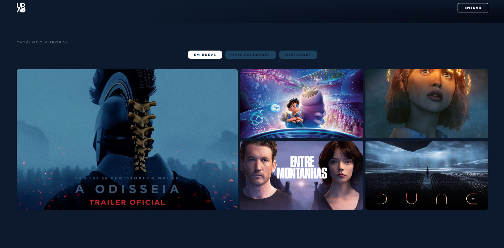

<p align="center">
  
</p>

<p align="center">
Uma experiência de streaming inspirada nas maiores plataformas do mercado, unindo design moderno, navegação intuitiva e foco total na experiência do usuário.
</p>

<p align="center">
  
  
  
  
  
</p>

---

## Sobre o Projeto

**Aurora+** é uma landing page inspirada nas principais plataformas de entretenimento e streaming do mercado, desenvolvida com foco em performance, identidade visual e experiência do usuário.

O projeto simula o ambiente de um catálogo digital de filmes e séries, apresentando uma interface moderna e imersiva que remete às plataformas utilizadas por milhões de usuários ao redor do mundo.

Toda a construção visual foi planejada para transmitir:

- Modernidade
- Imersão visual
- Navegação intuitiva
- Performance
- Responsividade

---

## Design & Conceito

Além do desenvolvimento Front-end, um dos principais diferenciais deste projeto foi a criação da identidade visual da plataforma.

A marca **Aurora+** foi concebida desde o início para transmitir modernidade, entretenimento e tecnologia, características presentes nas principais plataformas de streaming do mercado. A criação da logo envolveu estudos de composição, contraste, legibilidade e reconhecimento visual, buscando uma identidade forte e memorável para a aplicação.

Todo o processo de design foi desenvolvido utilizando o **Adobe Illustrator**, ferramenta empregada para:

- Desenvolvimento da logo Aurora+
- Construção da identidade visual da plataforma
- Vetorização e refinamento dos elementos gráficos
- Definição da paleta de cores
- Estudos de composição visual e branding
- Criação de materiais gráficos para a interface

A proposta foi unir:

- Branding moderno
- Design minimalista
- Experiência cinematográfica
- Interface inspirada em serviços de streaming
- Responsividade e usabilidade

O resultado é uma plataforma visualmente consistente, capaz de transmitir profissionalismo e reforçar a proposta de um catálogo premium de entretenimento digital.

---

## Tecnologias Utilizadas

### Front-end

- HTML5
- CSS3
- JavaScript

---

## Funcionalidades

- Catálogo visual de filmes e séries
- Layout totalmente responsivo
- Seções organizadas por categorias
- Navegação fluida
- Interface inspirada em serviços de streaming
- Organização dinâmica dos conteúdos
- Design otimizado para desktop e dispositivos móveis

---

## Estrutura do Projeto

```bash
📦 Aurora+
 ┣ 📂 img
 ┣ 📂 images
 ┣ 📜 index.html
 ┣ 📜 style.css
 ┣ 📜 script.js
 ┗ 📜 README.md
```

---

## Objetivo Acadêmico

Projeto desenvolvido como parte das atividades práticas da **EBAC (Escola Britânica de Artes Criativas e Tecnologia)**, aplicando conceitos de desenvolvimento Front-end, responsividade, organização de interfaces e construção de experiências digitais inspiradas em plataformas reais do mercado.

---

## Preview do Projeto

Acesse a versão online do projeto:

🔗 **[Aurora+](https://projeto04-ebac-aurora.vercel.app/)**

---

## Autor

**Eryck Ferreira**

Desenvolvedor Front-end em formação, apaixonado por criar interfaces modernas, responsivas e experiências digitais visualmente impactantes.

---
